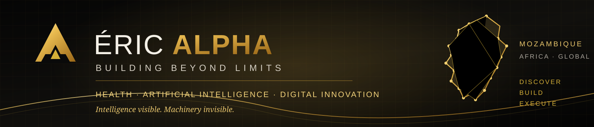

  

# Éric Xavier | Éric ALPHA

### Pharmacist · Public Health Professional · AI & Digital Innovation

**Building practical solutions at the intersection of health, technology and African innovation.**

Based in Mozambique 🇲🇿

---

## About

I am a Mozambican pharmacist working in public health and pharmaceutical supply chain management. My professional experience includes quantification, procurement and the design of stronger health-system processes.

That work has shaped my interest in using data, technology and better-designed systems to solve complex, real-world problems.

I am exploring applied artificial intelligence, intelligent agents, digital products and automation — with a practical focus on solutions that can create value in African contexts.

I believe technology matters most when it makes people's work clearer, faster and more effective.

## Areas of Work & Exploration

- **Public Health & Pharmacy** — pharmaceutical supply chains, quantification, procurement and health systems.
- **Artificial Intelligence** — applied AI, AI agents, personal knowledge systems and human-centred automation.
- **Digital Innovation** — digital products, low-code development, workflow design and practical software experiments.
- **Entrepreneurship** — turning ideas into useful products and sustainable initiatives with African relevance.

## Current Projects

### [ALL-ALPHA](https://ericalpha37.github.io/all-alpha/)

A digital knowledge and publishing ecosystem focused on learning, innovation, entrepreneurship and opportunities with an African perspective.

### JARVIS ALPHA

A personal cognitive operating system in development — exploring how knowledge, memory, tools and decision-making can work together to support focused execution.

## Principles

- Build with purpose.
- Stay curious and keep learning.
- Test ideas against reality.
- Prefer evidence over assumptions.
- Execute with discipline.
- Design for usefulness and impact.

## Technologies & Interests

Artificial Intelligence · AI Agents · Automation · Low-Code Development · Python · JavaScript · TypeScript · Digital Health · Data Systems · Pharmaceutical Supply Chains

*These are areas of practice, exploration and continued learning — not a claim of equal proficiency across every technology.*

## Português

Sou farmacêutico moçambicano e profissional de saúde pública, com experiência na cadeia de abastecimento farmacêutico, quantificação e procurement.

Interesso-me pela aplicação prática da inteligência artificial, pelo desenvolvimento de sistemas digitais e pela criação de soluções que respondam a problemas reais.

Quero contribuir para um futuro em que conhecimento, tecnologia e execução disciplinada se traduzam em resultados concretos para Moçambique, África e o mundo.

---

**Mozambique 🇲🇿 · Building for Africa and the world.**

*Intelligence visible. Machinery invisible.*
